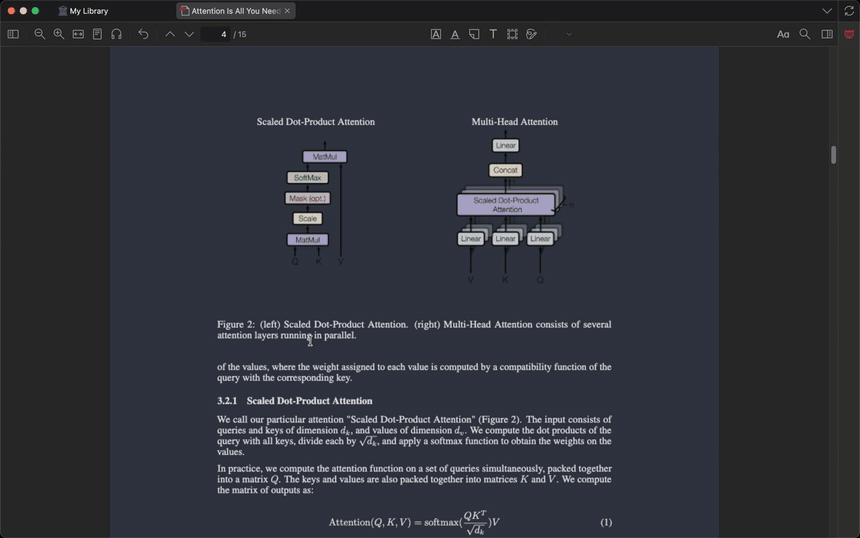
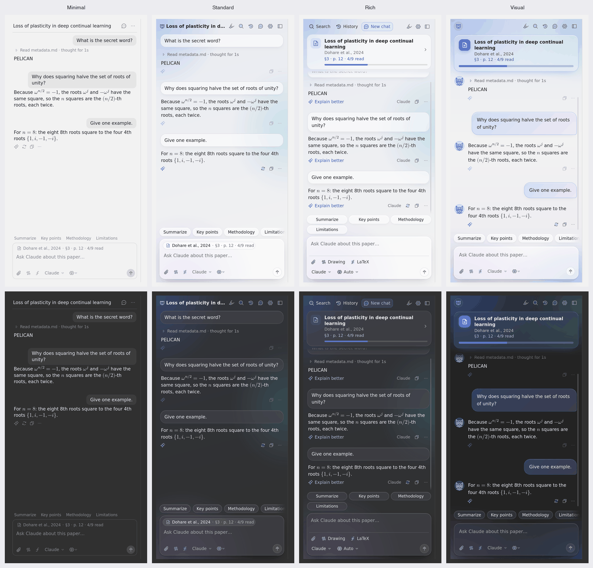
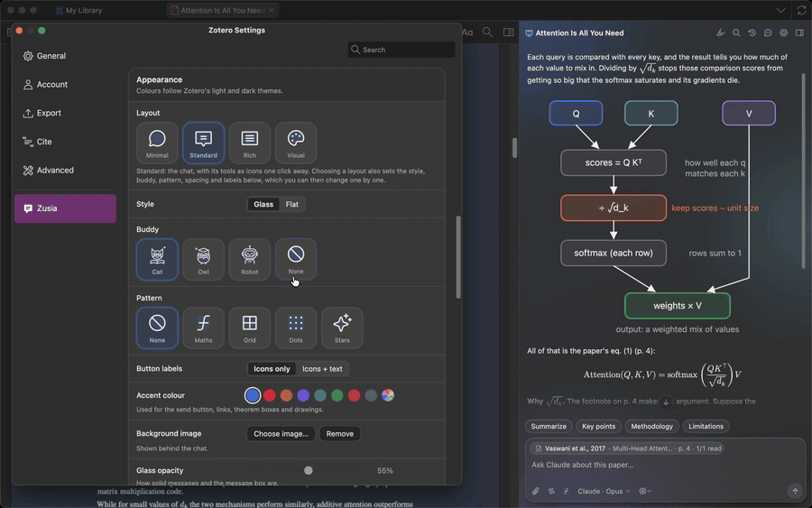
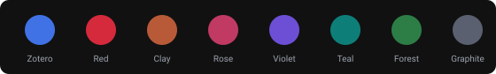
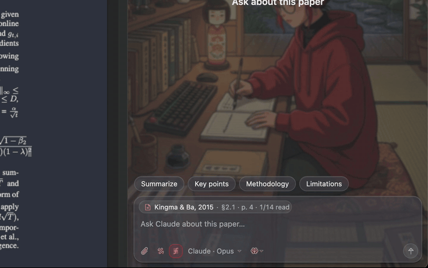
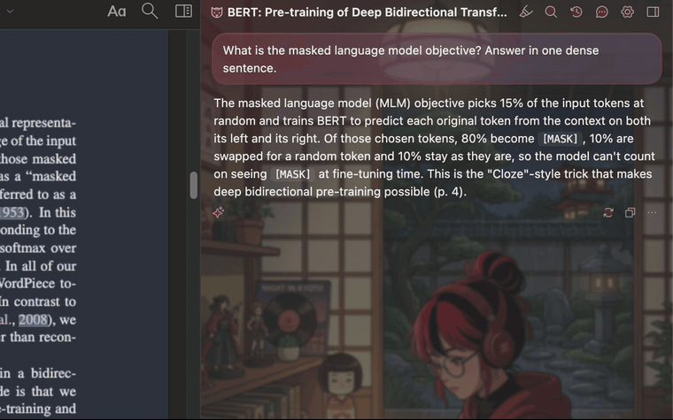
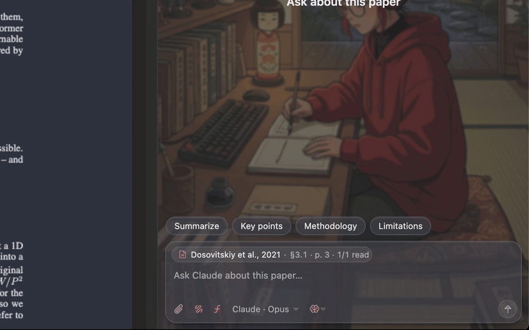

<p align="center"></p>

<h1 align="center">Zusia</h1>

<p align="center"><b>Your study buddy inside Zotero.</b><br>Ask about the paper you're reading. Get maths, drawings and proofs back.</p>

<p align="center">
  <a href="https://github.com/firekern/zusia/actions/workflows/ci.yml"></a>
  <a href="https://github.com/firekern/zusia/releases/latest"></a>
  
  
  
  <a href="LICENSE"></a>
</p>

<p align="center"></p>

**TL;DR**

- 💬 A chat **next to the PDF** that reads the **whole paper**, in its own panel at the side of the window.
- ✏️ Answers with **LaTeX**, **drawings** and numbered **theorem boxes**.
- 🔑 Uses **Claude Code, Codex or Antigravity** with your own login. No API keys.
- ⏱️ Install in 2 minutes: [jump to Install](#install).

<p align="center"></p>

## 1. Ask about the paper

> **Open a paper and ask.** Zusia is the panel on the right of the window, beside your library and the PDF. It follows the paper you select or open; drag its edge to resize it, and **⌥Z** (Alt+Z) hides it and brings it back. Turn on *Drawing* and *LaTeX* for a diagram and real maths.
>
> The recordings on this page were made with the chat in Zotero's item pane, on the right. It can still live there: **Settings → Zusia → Chat → *Where the chat is***.
>
> Real recording: Zotero on a Mac, *Attention Is All You Need*, a live answer from Claude. 27 seconds, with the wait sped up.

<p align="center"></p>

<p align="center"><a href="docs/videos/zusia-chat.mp4">▶ Watch in full quality (MP4)</a></p>

## 2. Make it yours

> **Settings → Zusia → Appearance → *Layout*.** Four ways to see the chat. *Minimal*: the conversation and the message box. *Standard*: the tools as icons, one click away. *Rich*: a card for the paper with your reading progress, the tools by name. *Visual*: your buddy beside each answer, bubbles, prompt cards and colour. The setup wizard asks on first run.

<p align="center"></p>

> **Then everything else in Settings → Zusia.** Style, buddy, pattern, accent colour, background image and button labels, all updating live in the chat. Glass, corners, font, answer length, level, tone and the system prompt are there too.

<p align="center"></p>

<p align="center"><a href="docs/videos/zusia-style.mp4">▶ Watch in full quality (MP4)</a></p>

<p align="center"></p>

<p align="center"><sub>Eight accents. Red on black is the one in every video here.</sub></p>

## 3. Follow a proof

> **Turn on *LaTeX*.** Definitions, lemmas and theorems come back as numbered boxes, and every `\ref` is a link: click to jump, **Back** (⌥←) to return.

<p align="center"></p>

<p align="center"><a href="docs/videos/zusia-proof.mp4">▶ Watch in full quality (MP4)</a></p>

## 4. Didn't click? Ask again, better

> **One button under every answer.** It comes back with the intuition first, then the steps, an example and the usual trap.

<p align="center"></p>

<p align="center"><a href="docs/videos/zusia-explain-better.mp4">▶ Watch in full quality (MP4)</a></p>

## 5. Ask about a figure

> **📎 → *Current PDF page*.** The page you are looking at goes with the question, so figures and tables can be asked about. Upload, paste, drop or screenshot work too.

<p align="center"></p>

<p align="center"><a href="docs/videos/zusia-figure.mp4">▶ Watch in full quality (MP4)</a></p>

<p align="center"></p>

## Everything else, in one line each

| | Feature | How |
|:--:|---|---|
| 🔴 | **Explain a passage** | Select text in the PDF → *Explain this* |
| 🟠 | **Ask about a passage** | Select text → *Ask your assistant about this*, then add your question |
| 🩷 | **Clarifications** | Every Ask and Explain is saved: highlighter icon → passage, prompt, answer |
| 🟣 | **Notes** | Save any answer or drawing as a Zotero note under the paper |
| 🔵 | **Search** | 🔍 searches the chats of every paper |
| 🟢 | **Models** | Pick assistant, model and reasoning effort from the message box |
| 🟤 | **Memory** | `/remember` a note, `/forget` one; click the paper chip above the message box to see, edit or reset what Zusia keeps |
| 🟡 | **Printed pages** | Ask about "page 18" and the assistant reads the page printed 18, whatever its PDF number |
| ⚫ | **Setup** | A visual wizard on first run, including the assistant's voice: a preset or your own system prompt |
| ⚪ | **Side panel** | ⌥Z / Alt+Z shows and hides it; drag its edge to resize, double-click the edge to reset; put it on the left, the right or in the item pane in Settings |

## Install

1. **Install one assistant CLI** and sign in: [Claude Code](https://docs.anthropic.com/en/docs/claude-code), [Codex](https://github.com/openai/codex) or Antigravity (`agy`).
2. **Download `zusia.xpi`** from the [latest release](https://github.com/firekern/zusia/releases/latest).
3. **In Zotero:** Tools → Plugins → ⚙ → *Install Plugin From File…* → pick the `.xpi`. Restart if asked.
4. **Open a paper.** Zusia appears in a panel on the right and starts the setup wizard. To have it on the left or in Zotero's item pane instead, choose **Settings → Zusia → Chat → *Where the chat is***.

Updates arrive on their own after that: Zotero checks the release feed.

## What the assistant reads

- 📄 **The paper's full text**, as Zotero extracts it from the PDF (split by page), EPUB or web snapshot. Answers cite pages as *(p. N)*.
- 🎯 **Where you are.** The page on screen and the passage you selected come first, with the pages you have turned to so far. Antigravity, which cannot read files, gets the pages that fit, chosen around that page and the question, and can ask for a few more.
- 🗺️ **A reading map**: the printed page labels, the outline with page ranges, and where each equation, figure and table is. A book is split into section files, whatever its length.
- 🧠 **What it remembers about this paper**: what you understood, what is still unclear, how you like answers, your `/remember` notes and a running summary. Every few questions a short call to a cheap model (Claude Haiku, or Antigravity) brings it up to date.
- 🏷️ **Metadata and your annotations**: title, authors, abstract, highlights and comments.
- 🚫 **No text, no guessing.** For a scanned PDF with no text layer, the assistant says it cannot read the paper instead of answering from the abstract.

## Privacy

- 🖥️ The assistants run **on your computer** with your own login. Zusia has no server and needs no API keys.
- 📄 They get the paper's **full text, metadata and your annotations**, its reading map, your reading progress and its memory, plus any image you attach. The CLI sends them to its provider (Anthropic, OpenAI or Google), as it does with anything you type into it.
- 🔕 To send only the metadata, abstract and annotations, turn off **Settings → Zusia → Chat → *Send the paper's full text***. *Track reading progress* in the same card stops noting the pages you turn to.
- 🧠 Keeping the memory takes extra calls to the same CLI, in the background. Turn them off in the Memory sheet (click the paper chip). Antigravity stores each of these calls in your `agy` conversation history.
- 📁 Chats, clarifications, images, the reading map, your reading progress and the memory stay in `zusia/` inside Zotero's data folder.

<p align="center"></p>

<details>
<summary><b>For developers: build, test, release, record the videos</b></summary>

## Build

```sh
npm ci
npm run build        # writes zusia.xpi
```

## Test

```sh
npm test             # unit tests (jsdom): rendering, settings, wizard, backends, repo checks
npm run shots        # screenshots of the UI in headless Firefox (optional)
npm run test:zotero          # the checks inside a real, headless Zotero (macOS app, or Flatpak on Linux)
npm run test:zotero:linux    # the same in Docker, against the official Linux build
npm run test:zotero:windows  # the same in the Windows build under Wine, in Docker
ZUSIA_BACKGROUND=path/to/illustration.jpg npm run videos   # re-records the README videos (macOS)
```

The videos are recorded in a real Zotero with its own demo profile and library, so your library is never used. The scenes move the real pointer: don't touch the Mac while they run. Needs `ffmpeg`, `cliclick`, the `claude` CLI, and Screen Recording and Accessibility permission for the terminal.

## Release

Bump `version` in `package.json` and `src/manifest.json`, then tag it:

```sh
git tag v1.1.0 && git push origin v1.1.0
```

The tag is what releases. `.github/workflows/release.yml` refuses to run if the tag and the two versions disagree, then runs the tests, builds the `.xpi`, writes `updates.json` and attaches both to a GitHub release. Pushing to `main` never publishes anything.

New behaviour starts with a failing test; see [CONTRIBUTING.md](CONTRIBUTING.md).

</details>

## Credits

Icons: [Phosphor Icons](https://phosphoricons.com) (MIT). Maths: [KaTeX](https://katex.org) (MIT) and Latin Modern Math (GUST Font License). The study buddies are original to this project; the illustrations were made for Zusia with Google Gemini. Papers in the videos: arXiv 1706.03762, 1512.03385, 1810.04805, 2010.11929, 2005.14165, 1412.6980. Details in [THIRD_PARTY_NOTICES.md](THIRD_PARTY_NOTICES.md).

Zusia is MIT licensed. See [LICENSE](LICENSE).
